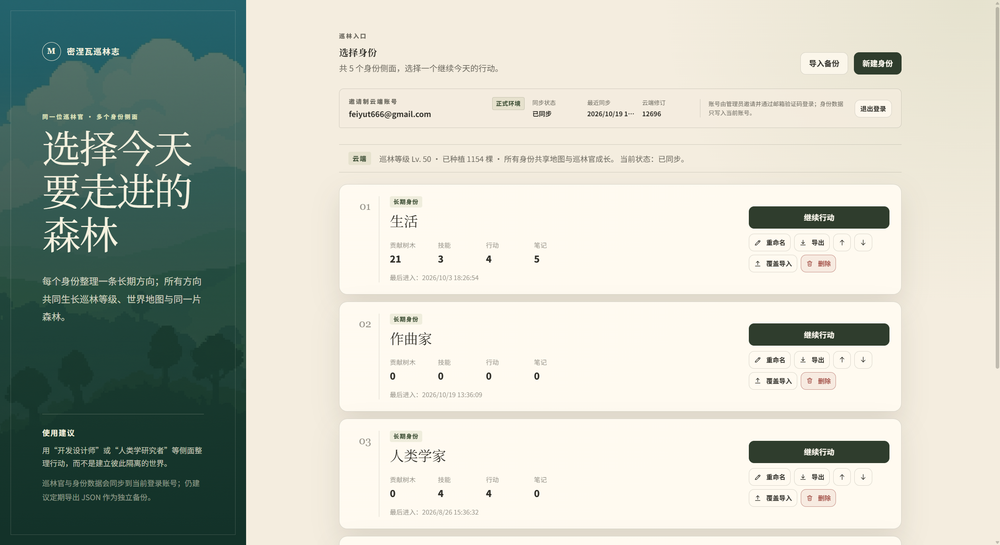
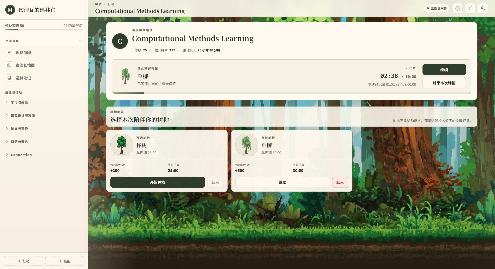
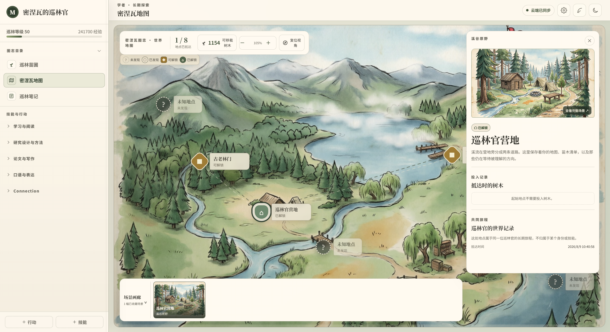
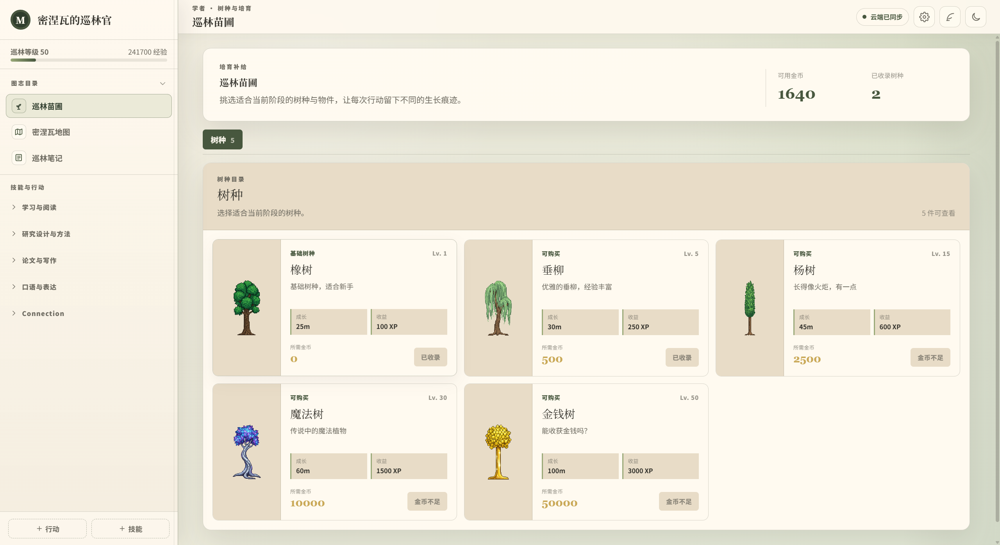

# 密涅瓦的巡林官

把专注种成一片森林。

## 起点

多数专注工具记录的是你专注了多久，数字留在统计里，用完就散。这个项目想把同一段时间放进一个会长大的系统：选一件要做的事，投入进去，结束后它长成一棵树，留在你的森林里。

形式上有两个参照：Forest 的「种树即专注」，和 Melvor Idle 那种反复投入、缓慢积累的放置感。

## 设计上的几个取舍

### 行动是基本单位

每个行动有自己的等级、经验、树木数量和累计时长。一次专注的收益直接结算到具体行动上，而不是汇总成一个总时长标签。做得多的行动自然长得高，放下的停在原地。

### 技能给行动分叉

行动归在技能下面，可以展开浏览、拖拽排序、重新归类。森林巡视按技能查看某个方向下有哪些行动、各自长成了什么样。

### 同一位巡林官，多个身份侧面

日常的事常常并行几条线，用身份侧面把它们分开：技能、行动、笔记和计时各属于一个身份，而巡林官等级、累计森林和地图进度由所有身份共享。删掉一个身份，它贡献过的成长不会倒退。身份可以新建、重命名、删除，也能导出成一份 JSON 带走，或从备份导入。

### 三种时间尺度

一次专注是一个行动周期，一片森林是更长的积累，地图和手记用来回望。

地图是长期探索：8 个地点分未发现、已发现、可解锁、已解锁四种状态，前置地点会显出后面的路。种树得到的树木可以移栽到地点上解锁场景，扣的是可用余额，不动行动森林里的累计成果。地图与场景画廊由所有身份共享，地点只承担探索叙事，不挂在某个技能下。

手记分三处。行动足迹按技能和行动回看植树记录与相关随笔；巡林随笔写阶段性的总结，支持 Markdown 编写、预览和检索；系统记录留下合并、删除这类变动。

### 做过的事留得下痕迹

行动合并时，笔记的目标和归属跟着走；行动或技能被删除，相关记录降级归档并保留名称快照，不会变成无主的散块。合并与删除都可以填一句说明，作为记录的一部分。

## 界面

**身份选择**：一位巡林官的几条方向并排放在一起，各自独立，共享等级与地图。

**行动仪表盘**：选一个树种开始专注，计时走完，它就长成森林里的一棵树。

**密涅瓦地图**与**巡林苗圃**：地图上的 8 个地点按四种状态逐步显现；苗圃用金币解锁新的树种。

| 密涅瓦地图 | 巡林苗圃 |
| --- | --- |
|  |  |

另有森林巡视与巡林笔记（行动足迹、巡林随笔、系统记录），日夜两套配色。

## 运行

需要 Node.js。`npm install` 之后，`npm run dev` 打开浏览器版本，`npm run desktop` 启动桌面版。
